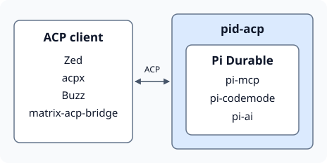

## Overview

pid-acp connects ACP clients to Pi Durable.



## Quickstart

```sh
npm ci && npm run build
PID_ACP_PROVIDER_CONFIG=/absolute/path/to/provider.mts \
  PID_ACP_MODEL=example-model node dist/main.js
```

## Features

- Skills
- `AGENTS.md`
- MCP
- Codemode
- User extensions
- ACP v1 (`initialize`, `session/new`, `session/load`, `session/prompt`, `session/cancel`)
- Steering (`_session/steering`)
- Tools (`bash`, `read`, `write`, `edit`)
- Transport (stdio, Unix socket)

## ACP → Durable SDK

| ACP method | Durable SDK call |
| --- | --- |
| `initialize` | None |
| `session/new` | `harness.createConversation()`, then `conversation.watch()` |
| `session/load` | `harness.snapshot()` and `harness.conversation()`, then `conversation.context()` and `conversation.watch()` |
| `session/prompt` | `conversation.submit({ type: "input", content, whenBusy: "followUp" }, context)`, then `submission.wait()` |
| `session/cancel` (notification) | `conversation.abort()` |
| `_session/steering` | `conversation.submit({ type: "input", content, whenBusy: "steer", whenIdle: "reject" }, context)` |

## Configuration

| Environment variable | Description |
| --- | --- |
| `PID_ACP_PROVIDER_CONFIG` | Absolute path to a trusted provider module, or a nonempty JSON array of absolute paths. Each module default-exports one Pi AI provider. |
| `PID_ACP_PROVIDER` | Default provider ID. May be omitted when exactly one provider ID is registered. |
| `PID_ACP_MODEL` | Default chat model ID registered by the selected provider. |
| `PID_ACP_THINKING` | Model thinking level; defaults to `off`. |
| `PID_ACP_INSTRUCTIONS` | Global instructions file; empty disables it. |
| `PID_ACP_SKILLS_DIR` | Global skills directory; empty disables it. |
| `PID_ACP_MCP_CONFIG` | MCP config file; empty disables MCP. |
| `PID_ACP_EXTENSIONS` | JSON array of absolute Durable extension paths. |
| `PID_ACP_SESSIONS_DIR` | Absolute directory for persistent sessions. |
| `PID_ACP_SOCKET_PATH` | Absolute Unix socket path; unset uses stdio. |

### Provider setup

The configured default applies only to new sessions. Saved sessions load with their original provider and model IDs. If that pair is unavailable, `session/load` fails instead of falling back to the default.

For one provider, use the quickstart above and let pid-acp infer the provider ID. For multiple providers, select the default provider and model separately:

```sh
PID_ACP_PROVIDER_CONFIG='["/absolute/path/to/provider.mts","/absolute/path/to/other.mts"]' \
  PID_ACP_PROVIDER=example PID_ACP_MODEL=example-model node dist/main.js
```

Providers register in array order. Duplicate provider IDs follow Pi AI replacement semantics: the later provider replaces the earlier one. Different providers can register the same model ID.

Example `provider.mts`:

```ts
import { createProvider } from "@earendil-works/pi-ai";
import { openAICompletionsApi } from "@earendil-works/pi-ai/api/openai-completions.lazy";

export default createProvider({
  id: "example",
  name: "Example",
  baseUrl: "https://api.example.com/v1",
  api: openAICompletionsApi(),
  models: [{ id: "example-model" /* add Pi AI model metadata */ }],
  // Add authentication if required.
});
```

### User extension sketch

Set `PID_ACP_EXTENSIONS='["/absolute/path/to/todo.mts"]'`.

```ts
import { defineExtension } from "@earendil-works/pi-durable";
import { todoTool, todoSection } from "./todo-state.mts";

export default defineExtension({
  name: "user.todo",
  tools: [todoTool],
  sections: [todoSection],
});
```

## AI disclosure

Built with 6.1 Sol, 6.2 Sol, and 6.2 Astra.

Initial project prompt:

> make mr for a spec doc with a svg diagram for replacing pi rpc with pi durable in pi-acp. what's the minimal tracer bullet to poc?
