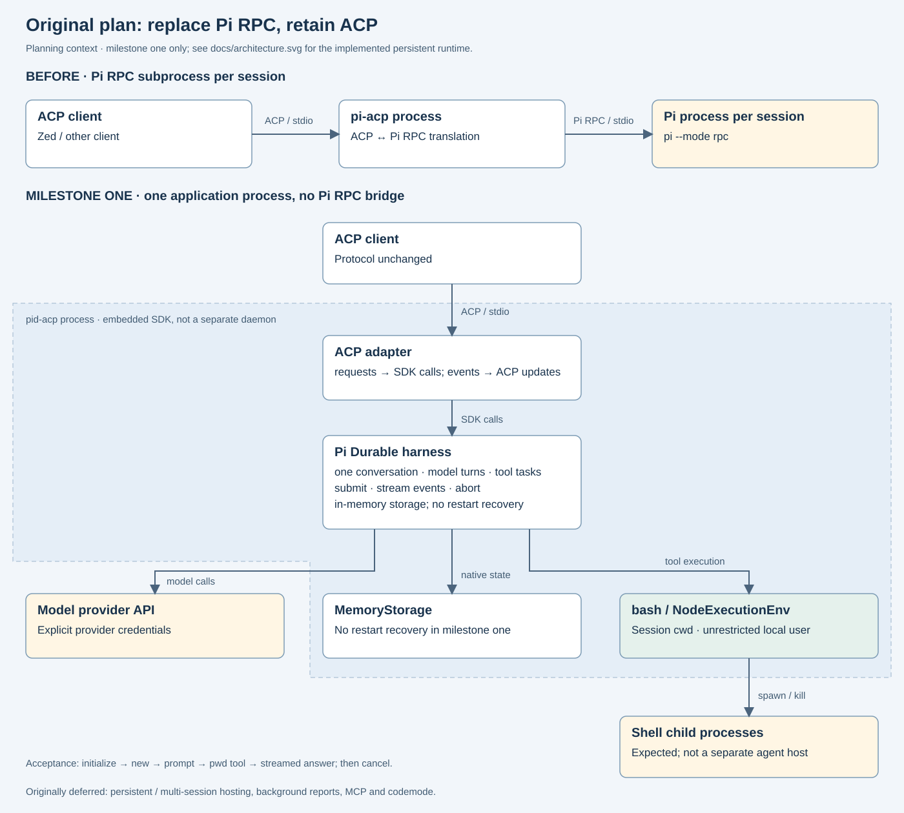

+++
status = "draft"
created = 2026-10-22
last_update = 2026-10-22
+++

# Milestone 1: ACP to Pi Durable skateboard

## Purpose

Prove that an ACP client can drive a useful agent through Pi Durable directly, without a Pi CLI subprocess or Pi RPC bridge. This is the first milestone for `pid-acp`, not a replacement for the user's working stack yet.

## Context

Today, pi-acp translates ACP requests into `pi --mode rpc` commands and manages a Pi process per session. Its ACP handlers also depend on Pi-specific session files, settings, commands, and event shapes; replacing only the process class is insufficient.

The proposed application uses pi-acp as guidance for ACP behavior while implementing the runtime boundary with the Durable SDK. One application process will eventually host multiple conversations. Shell commands and stdio MCP servers can still require child processes.

## Goals

- Complete one real ACP prompt through a directly embedded Durable harness.
- Stream assistant text and expose a shell tool call and result to the client.
- Cancel active work and accept a subsequent prompt in the same session.
- Establish a small ACP-to-Durable boundary that can later support persistence and multiple conversations.

## Non-goals

- Feature parity with pi-acp, regular Pi, or pi-processes.
- Session load/list/delete, history replay, session-file migration, or crash recovery.
- Persistent storage, background jobs, unsolicited completion turns, or process reattachment.
- MCP, codemode, subagents, scheduling, or a reusable workflow framework.
- Loading existing Pi extensions, skills, prompt templates, settings, or login credentials.
- Model selection UI, OAuth, attachments, slash commands, usage display, or structured edit diffs.
- Remote hosting, multiple ACP connections, multi-user authorization, or sandboxing.

## Specification

### Implementation boundary

[svkozak/pi-acp](https://github.com/svkozak/pi-acp) is a reference for ACP behavior, not a required codebase or architecture. The implementation may be written independently and must advertise only supported capabilities. If upstream code is copied or adapted, record its revision and preserve applicable MIT notices.

The server must use the ACP TypeScript SDK over stdio and call `@earendil-works/pi-durable` directly. It must not launch `pi`, implement a Pi RPC compatibility shim, or require the Pi CLI on PATH. Stdout must contain only ACP protocol traffic; diagnostics belong on stderr.

The implementation must pin tested SDK versions and commit a lockfile. Durable is experimental; the README must state the tested Node version and dependency versions.

### Host and session lifecycle

- One server process must own one harness using `MemoryStorage` and one active ACP session backed by one Durable conversation.
- Startup must configure one provider/model explicitly through CLI arguments or environment variables, with provider credentials supplied through its supported environment configuration. The README must document one tested provider. Missing required configuration must fail with an actionable error, without exposing secrets.
- `initialize` must advertise only implemented capabilities. In particular, load-session and MCP support must not be advertised.
- `session/new` must create a conversation with the requested existing absolute working directory. Its ACP session ID must identify that conversation for the lifetime of the process.
- A second `session/new` must return an explicit error without replacing active work. Multi-session support is deferred, not architecturally prohibited.
- Unknown session IDs and invalid working directories must fail explicitly. Nonempty MCP configuration and nontext prompt content must be rejected, not silently ignored.
- A prompt received while another prompt is active must be rejected explicitly; steering and follow-up queues are deferred.
- Stdin EOF or a termination signal must stop accepting requests, abort active work, close the harness, and clean up the execution environment before exiting, subject to a bounded shutdown timeout.
- Restart creates an empty service. No persistence or automatic reconnection guarantee is claimed in this milestone.

### Prompt and event bridge

The adapter must submit text inputs with `conversation.submit()` and track the returned submission through settlement. It must subscribe before submission so immediate output is not missed, translate Durable events to ACP updates, and release subscriptions when the session closes.

| ACP operation or update | Durable responsibility |
| --- | --- |
| Session creation | Create the conversation and configure its model and cwd |
| Text prompt | Submit an input and wait for that submission's outcome |
| Assistant text chunks | Translate committed assistant text deltas to `agent_message_chunk` |
| Tool call and updates | Translate tool start, output, and settlement to ACP `tool_call` / `tool_call_update` with stable IDs |
| Prompt completion | Settle the ACP response after the answer's final updates are delivered |
| Cancellation | Abort active conversation work and settle the pending prompt as cancelled |

A successful run must return ACP `end_turn` only after its final answer updates have been delivered. Cancellation must return `cancelled`. Provider/runtime failures must settle the pending prompt with an ACP error and emit a diagnostic; they must not hang the request or be reported as successful answers. A failed shell command must appear as a failed tool result; the model may still answer normally afterward.

A client must not receive duplicate text because the initial Durable snapshot overlaps later deltas. Terminal tool updates must precede prompt completion. Thinking output is not required and must not be mislabeled as assistant answer text.

### Minimal tool surface

Only Durable's built-in `bash` tool must be enabled, using `NodeExecutionEnv` rooted at the session cwd. The process runs with the local user's privileges; the cwd is not a sandbox. The README must warn that this POC grants unrestricted local shell execution and is for trusted local use only. There is no approval workflow in this milestone.

The demonstration prompt is: “Run `pwd` using the shell tool, then tell me the directory.” The client must display the tool lifecycle, its output, and the final answer containing the requested session directory.

No background task is needed to prove the runtime replacement. Normal tool settlement already continues the model run; asynchronous result injection is separate work.

### Reference mapping

This mapping describes equivalent responsibilities, not required code reuse.

| Existing pi-acp area | Milestone-one responsibility |
| --- | --- |
| Stdio entrypoint and ACP SDK wiring | Implement ACP stdio transport |
| ACP request dispatch and text/tool presentation | Implement the supported ACP subset using Durable events |
| `src/pi-rpc/*` | Omit; replace with direct Durable calls |
| Session manager | Replace subprocess ownership with harness/conversation handles |
| Pi session store/history readers | Omit; use an in-memory session binding |
| Pi settings/auth/commands and extension UI bridge | Omit; use explicit POC configuration |

The Durable adapter must expose conversation operations, not fake Pi RPC messages. Extract an interface only if the implementation needs one; maintaining both runtime backends is not required.

## Verification

The milestone is complete when all of the following pass:

1. **Protocol integration:** an automated ACP client initializes the server, creates a session in a temporary directory, prompts, receives multiple text updates, and observes `end_turn`. A scripted/faux provider makes CI deterministic and requires no credentials.
2. **Tool round trip:** a scripted model requests the real bash tool, executes `pwd`, consumes its result, and answers. Assertions cover stable tool IDs, lifecycle ordering, output, and cwd.
3. **Cancellation:** cancel a deliberately blocked model/tool run; the pending prompt resolves as cancelled within five seconds in the controlled test environment, tracked shell children are cleaned up, and a new prompt succeeds in the same session.
4. **Errors:** missing configuration, invalid/unknown sessions, overlapping prompts, unsupported input, and a simulated provider failure produce explicit failures without protocol corruption or hung requests. A nonzero shell exit produces a failed tool update.
5. **Direct SDK boundary:** the application must call Durable directly and must not launch Pi or contain a Pi RPC shim. Normal tool round-trip and cleanup tests verify execution behavior; a separate restricted-PATH suite is not required.
6. **Shutdown:** disconnect the ACP client during active work and verify bounded server exit and shell cleanup.
7. **Real client smoke:** connect Zed or another existing ACP client, complete the `pwd` demonstration using a real provider, and cancel a run. Record the exact client/runtime versions and commands in the implementation MR, without credentials.

A successful SDK-only demo is insufficient: the acceptance path must cross the ACP stdio boundary. This spec MR requires only Markdown/link checks and valid, readable SVG; it does not contain the implementation.

## Rationale

Text streaming alone would miss the tool/event boundary where much of pi-acp's coupling lives. One shell round trip plus cancellation tests that boundary without rebuilding the agent platform. In-memory storage keeps the first milestone focused; persistence and crash recovery must be demonstrated separately before they become product claims.

## Subsequent milestones

These are sequencing proposals, not requirements for milestone one:

1. **Persistent multi-session host:** SQLite storage, concurrent ACP sessions in one process, load/history replay, and reconnect handling. Verify crash recovery with explicit interrupted-tool policies and no duplicate external effects. Durable recovery cannot settle an ACP request on a dead connection.
2. **Background completion:** a tool creates a background task and returns immediately; a reporter explicitly submits its result with a stable request ID. Verify the chosen ACP client can display and cancel a model run initiated after an earlier prompt has ended. Define behavior when no client is attached.
3. **Usable daily driver:** prioritize required credentials, skills/prompts, MCP, codemode, permissions, and selected extension ports. Do not claim regular Pi extension compatibility.
4. **Process management:** start/status/logs/stop and readiness notifications. Define interrupted-job behavior first; surviving harness crashes requires external process supervision or an independently reconnectable runner, not merely a Durable task.

## Open questions

- Which provider/model should be the real-client smoke-test baseline?
- Which existing Pi extensions and configuration behaviors are required before switching daily use?
- Does the target ACP client support unsolicited background-run updates acceptably, or should later work use a different delivery contract?

## References

- [pi-acp](https://github.com/svkozak/pi-acp): Reference for ACP behavior and presentation; code reuse is optional.
- [Pi Durable SDK](https://github.com/earendil-works/pi/tree/main/packages/durable): conversations, events, tools, and execution environments.
- [Background subagent example](https://github.com/earendil-works/pi/blob/main/packages/durable/test/examples/23-subagent-background.ts): explicit completion reporting for a later milestone.
- [ACP](https://agentclientprotocol.com/overview/introduction): external client/server protocol; it remains JSON-RPC even though the internal Pi RPC bridge is removed.
