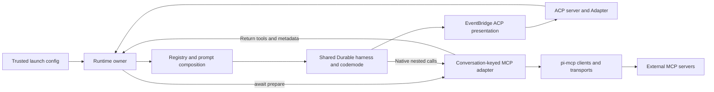

+++
status = "draft"
created = 2026-11-13
last_update = 2026-11-25
+++

# MCP tools through standalone pi-mcp

## Purpose

Let pid-acp sessions use trusted launch-configured MCP tools through Durable
codemode. Preserve structured results, conversation isolation and native unsafe
recovery without loading Pi settings, extensions or a second agent process.

## Context

This extends [native codemode](005-durable-codemode.md) and
[shared conversations](007-multiple-conversations.md). Runtime owns one Harness,
registry, sandbox and conversation-keyed environments. Session is a non-owning
attachment; EventBridge presents only parent codemode calls. Startup resumes saved
work without an ACP client. ACP-supplied MCP servers remain unsupported.

The pinned public contracts are pi-mcp, Durable, pi-codemode and pi-schema 1.5.2.
pi-mcp supplies transports, configuration validation, names, input normalization,
pagination, cancellation and content conversion. Durable supplies nested admission,
argument/result validation, execution, journals and unsafe recovery. The adapter
must use those contracts rather than implement a protocol, schema dialect,
subprocess supervisor or recovery framework.

## Goals

- Discover and call stdio and Streamable HTTP tools through standalone pi-mcp.
- Expose collision-safe, codemode-only tools and structured results.
- Isolate clients by native conversation identity, including equal workspaces.
- Reuse and refresh a Pi CLI service grant for opted-in HTTP servers.
- Keep setup, execution and cleanup explicit at their owning components.

## Non-goals

- Project/ACP server configuration, in-process sign-in, custom auth providers,
  `!cmd` helpers, hot reload, automatic reconnect, tool-list updates, resource APIs,
  prompts, sampling, elicitation and Apps.
  Embedded resource blocks in tool results remain supported.
- Direct/deferred model exposure, owner-specific schema variants, schema unions,
  resource-ID rewriting, persisted catalogs, migrations or old-command fallback.
- Automatic replay of failed calls, exactly-once effects or child supervision
  across process crashes.

## Specification

### Architecture and ownership

The original planning diagram is retained below. The implementation flow is
`Runtime -> async registry factory -> temporary MCP discovery -> registry/codemode
-> Harness`; native environment allocation then prepares execution clients.
All application responsibilities remain in one process.

Runtime awaits `createCodingRegistry(sandbox, mcp)` before opening Harness. That
factory installs native tools and skills, then discovers the MCP tools and
namespaces through temporary clients using the canonical launch cwd. After those
clients close, it installs codemode with the discovered namespaces and
`models: false`, followed by the MCP extension. MCP supplies ordinary
Durable registrations and metadata without registry or sandbox dependencies.
No discovery callback, observer or tool-triggered installation is needed.

MCP owns execution clients keyed by `(conversationId, server)`, never cwd or
attachment ID. Runtime's cached native environment allocation awaits
`mcp.prepare(conversationId, cwd)` once; prepare creates execution clients, not
registrations. Dormant saved conversations and attachment loads create no clients.
Session/Adapter neither create nor dispose clients. Keep native tools and saved
filters unchanged.

### Trusted configuration

Read `~/.pi/agent/mcp.json` at launch. A nonempty absolute `PID_ACP_MCP_CONFIG`
replaces that path; an empty value disables MCP. A missing default means no servers;
an explicit missing file or malformed JSON fails startup. Ignore
`PI_CODING_AGENT_DIR`, project `.pi/mcp.json` and Pi settings. Use the Pi OAuth
store only for explicitly opted-in servers.
ACP requests must still supply `mcpServers: []`.

Trust the selected file: use ordinary file reading and JSON parsing, including
ordinary symlink/permission and duplicate-key behavior. This configuration grants
local execution/network authority; it is not an untrusted-file security boundary.
Use `read -> validate -> normalize`: validation checks and throws without changing
the parsed object or returning a representation. Delegate base validation to public
`validateMcpServerConfig`, without a parallel base-field allowlist. Normalization
expands env/header values, canonicalizes exposure and creates tagged entries from
the checked object; it adds no freeze-only copying. Unknown inert extension fields
are ignored, not forwarded as transport options. Disabled entries skip validation and never connect.

Support command/args/env/cwd or url/headers, enabled, description, upstream positive
timeout seconds (default 60), exposure and toolExposure. Upstream selects HTTP
when command and URL coexist without a type. Stdio uses pi-mcp's default full
process-environment inheritance plus explicit env overrides. This includes provider
credentials. Accept boolean `inheritEnv`; false passes only explicit env, including
PATH/HOME when needed. Do not construct a custom minimal child environment.
Execute an argv vector, not a shell string. Resolve relative cwd against the
canonical conversation workspace.

Exposure defaults to `codemode`; accept `codemode-deferred` as an alias and `hidden`.
Exact toolExposure names beat the first matching `*` pattern. Hidden tools never
register. Reject direct/deferred model exposure, custom auth-provider fields,
configured roots, `!cmd` helpers and `autoEnableCodemode: false` with sanitized
correction guidance, without echoing values or upstream server-name interpolation.

Expand `${NAME}` once in env/header values from the launch environment. Missing
variables disable only that server with a field-category error. Do not execute
helpers, expand URLs, recurse or persist expanded values. Non-OAuth servers use
upstream HTTP/HTTPS URL semantics. Static headers support bearer/API-key
authentication. All HTTP transports reject redirects.

### Pi-bootstrapped OAuth

An HTTP `oauth` entry must specify a literal pre-registered public `clientId` and
may include Pi's `scope`, `callbackPort` and `callbackUrl` sign-in settings. Reject
confidential/dynamic clients, client metadata documents, issuer overrides, custom
auth providers, Authorization header conflicts, enabled namespace aliases that
involve OAuth, and non-loopback cleartext OAuth endpoints.

Use the actual private Pi named store at `PID_ACP_MCP_AUTH_FILE` or
`~/.pi/agent/mcp-auth.json`, keyed by namespace and normalized URL. Never migrate
URL-only records. Require a renewable bearer grant. The operator must bootstrap
with the same name, URL, and client ID; Pi does not normally record a configured
ID in the grant. Stop or drain all refreshers before login, logout, or
reauthorization; the browser flow is not covered by the refresh lock.

Share one provider per server across process discovery and conversation clients.
Supply tokens from the store without expiry refresh; delegate challenge recovery
to pi-mcp using redirect-rejecting fetch for discovery and token requests. Keep
refreshes serialized using Pi-compatible locks. No browser flow in pid-acp.
Give safe login/restart guidance on missing or revoked authorization, distinct
from store/configuration, lock or other transport failures.

### Fixed setup and discovery

Use public `StdioTransport`, `StreamableHttpTransport` and `McpClient`. Capture stdio
stderr without copying it to diagnostics. Disclose only the connection's canonical cwd
as a root; roots are not a sandbox. Query tools only when advertised; pi-mcp owns
pagination and response checks. Temporary discovery uses launch cwd; configure an
absolute server cwd when needed. Execution-client setup uses native conversation
cwd. Connect during owned setup, not tool calls or attachment load. Startup
discovery failure aborts launch. Later execution-client setup failures leave native
tools and healthy connections usable; render sanitized status in the prompt.

This first milestone assumes **stable connections and identical, stable tool
definitions across a configured server's conversation clients**. Temporary
startup discovery supplies that server's process-local registrations. Execution
clients connect with their own cwd/roots and reuse those definitions without
rediscovery, comparison or merging. Durable rejects duplicate registrations.
No per-owner catalog, schema union or discovery wrapper is needed.

Ignore `notifications/tools/list_changed`. Tools call only the already prepared
owning client; they never connect, rediscover or mutate registry composition.
Unexpected connection loss, tool removal or incompatible server behavior fails
through the ordinary upstream/native call boundary. Sanitize error details and
never retry ambiguous failures. pi-mcp may resend an OAuth-challenged request once
after recovery; only opt in servers that reject before applying effects.
Reconnect, hot reload and dynamic catalog consistency are out of scope; restart
to pick up changes.

Restart discards these definitions. Current file/current discovery then apply to
all sessions, including old ones. Users own compatibility and repair configuration
or start fresh work when unavailable tools or current schemas reject old calls.
Do not save catalogs, definitions, mappings, enrollment or configuration identities.

### Tool boundary

Sort servers and original names. Use public `createMcpToolName` with minimal
`isTaken` ownership of previously generated MCP names. Durable rejects duplicate
definitions in the single MCP extension. Add no local namespace, prefix or
cross-extension policy framework and no arbitrary server-name cap. Route closures
by original names, never reverse sanitized names. Unsafe-character aliases retain
deterministic suffixes.

Use `normalizeMcpInputSchema` without dropping constraints, definitions or local
references. Require object inputs and compile through public pi-schema with the
same formats as Durable to reject compiler errors before registration. Other
schema semantics belong to the pinned upstream boundary; pid-acp adds no dialect
walker, keyword allowlist, transformations or second argument validator. Use
schemas supported by that boundary rather than expecting general dialect conversion.

Register `callers: ["tools"]`, `deferred: true`, `replay: "unsafe"`. Only codemode
reaches model schemas. Durable's `api.executeTool` owns nested calls. Scripts use
native `searchTools`, `describeTool`, `describeNamespace`, `ALL_TOOLS` and `tools`.
Descriptions are untrusted text; omit server instructions. Keep ACP parent-only
for fresh work and persisted history, without nested-tool rows.

### Results, deadlines and cancellation

Scripts receive `{ content, structuredContent?, isError? }`, with supported raw
blocks and any structured JSON value, including null/arrays. Remove `_meta` only
from protocol metadata locations, preserving application `_meta` in structured
content. Reject invalid blocks/isError rather than repair arbitrary formats.
pi-mcp checks the protocol result container and transports provide wire JSON;
Durable validates the declared envelope. Server outputSchema is documentation,
not separately enforced structuredContent validation. Preserve empty errors.

Return the envelope as Durable structuredOutput, isError separately, and output
from public `toLlmContent`/`limitMcpContent`, with no custom output saver. Durable
applies its own output limits. Do not fetch links or render Apps metadata. Structured
errors resolve through codemode, so scripts must check `result.isError`.
Protocol/transport/validation/interruption failures reject with sanitized guidance.
Never add credentials, headers or transport IDs to results/details.

Pass the native abort signal to pi-mcp callTool. Forward numeric progress through
Durable api.output, omitting untrusted progress messages. pi-mcp owns idle timeout
renewal and suppresses callbacks after settlement. Use its transport message,
stderr, process-close and output defaults. Use configured call timeout and native
codemode deadlines; add no absolute call deadline, throttle or reconnect policy.

Use pi-mcp connect and close directly, without transport injection, forwarding
wrappers, memoized double-close or a custom setup deadline/AbortController.
Upstream request timeouts do not bound transport.start or initialized notification
send; this milestone adds no total setup guarantee.

ACP cancellation aborts Durable work, which cancels the owning MCP request.
Cancellation/timeouts cannot prove remote effects stopped and must not kill a
healthy sibling client. Attachment close/load rollback leaves Runtime-owned work
intact. After connection loss/session expiry, calls fail without new setup until
restart. Do not inspect LiveDoc or maintain per-submission retry state.

### Shutdown and persistence

Accepted Runtime close stops external admission, joins native work, then closes
all clients, including partial setup/failed discovery, then joins in-flight OAuth
refreshes before sandbox disposal. Use all-settled cleanup so failures cannot
skip owned resources. Apply the same cleanup to failed Runtime startup. Upstream stdio escalation fits the existing
four-second process deadline; add no subprocess supervisor. Hard deadlines report
failure rather than graceful success.

Preserve native transcripts, codemode journals and saved filters. Startup resumes
unattached work using current registrations. Historical presentation needs no old
server; session/load itself performs no discovery. Missing/incompatible calls fail
without blocking unrelated work. Do not add task repair or a second ledger.

Completed nested results are reused; interrupted unsafe intents fail natively
instead of repeating effects. Not-yet-dispatched work may run under native
scheduling. A lost response can follow a successful external mutation: tell users
to inspect the external system before repeating it. Hard crashes may leave children
or remote work alive; no crash supervision or reattachment is provided.

Keep secret expansion in memory. Diagnostics contain server identifiers and safe
categories, never stderr, raw HTTP bodies, URL query values, arguments, headers,
parser excerpts or transcripts. Tool outputs may contain secrets; protect sessions
and backups with existing private-storage requirements.

## Verification

Use only explicit disposable configs and credential-free fixture servers. Never
inspect or call personal MCP servers. Keep real native bash in integrations and
live model tests opt-in.

- Unit tests cover launch precedence/disable, ordinary JSON/file reading, unsupported
  active features, harmless extensions, secret expansion, upstream child-env defaults,
  explicit inheritEnv:false, names/exposure, upstream schema
  compilation, result envelopes/metadata/errors and presentation limiting.
- Native integrations use real disposable transports to cover async discovery and
  single registry composition, lazy execution clients, no implicit setup from calls,
  ignored list-change notifications and healthy siblings surviving execution-client
  setup failures. Startup discovery failures abort launch and close temporary clients.
- Real stdio/local HTTP production ACP exercises pagination, progress/idle timeout,
  cancellation, upstream response resumption, disconnected calls without new setup
  or mutation replay, two-conversation
  isolation, redirect confinement and upstream message/close limits.
- Persistent create/crash/restart/load uses current-file removed tools and changed
  schemas, reuses completed results and rejects unsafe interrupted effects. Test
  unattached recovery, unchanged saved filters and parent-only history.
- Cover normal/failed-start cleanup, partial setup, cancellation/next prompt on a
  healthy client, load rollback and child escalation. Assert no leaked fixture
  children or secrets.
- Use synthetic grants and loopback MCP/authorization servers to verify Pi CLI
  bootstrap and reauthorization, disk restart, rotation with cross-process
  contention, concurrent conversations, redirect rejection, cancellation/shutdown,
  and redaction in diagnostics and saved output.
- Run npm ci, build, strict source/test typecheck, lint, format and full
  deterministic suites. Record outcomes in the PR, not repository documents.

## References

- [Persistent sessions](004-persistent-sessions.md) and the extensions linked above.
- [pi-mcp README](https://github.com/earendil-works/pi/blob/da705e129fef92980c6033888439e2d76d1e0d86/packages/mcp/README.md).
- Published pinned package declarations and implementations under pi-mcp,
  pi-durable, pi-codemode and pi-schema are the executable contract.
