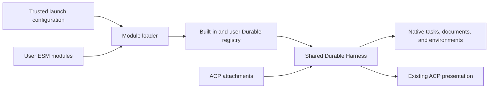

+++
status = "draft"
created = 2026-11-17
last_update = 2026-11-19
+++

# User extensions through native Durable modules

## Purpose

Let operators load trusted user code into pid-acp without changing its source.
Separately maintained extensions can supply tools, tasks, prompt sections, hooks,
and wrappers while Durable owns execution, state, cancellation, and recovery.

## Context

Runtime composes coding, skills, MCP, and codemode extensions in one shared registry
before opening the Harness. This adds module loading to that composition, not a new
extension API. It extends [shared conversations](007-multiple-conversations.md),
[persistence](004-persistent-sessions.md), and [codemode](005-durable-codemode.md).
The native API is pid-acp's pinned Durable 1.5.2.

## Goals

- Load external native Durable extensions from trusted launch configuration.
- Install them before Harness opening and unattached recovery.
- Preserve native selection, tool exposure, execution, and persistence behavior.

## Non-goals

- Pi coding-agent extension compatibility, settings, commands, or UI.
- Package installation, automatic discovery, project or ACP-supplied configuration.
- Hot reload, sandboxing, or a pid-acp plugin SDK.
- Custom lifecycle callbacks, notification routing, ACP methods, or renderers.
- A process tool, scheduler, or recovery framework.

## Specification

### Architecture



Runtime owns the registry. It must load and install configured extensions before
`Harness.open`, recovery, or ACP admission. The loader passes no pid-acp internals
or custom host API to user modules.

### Configuration and entrypoints

`PID_ACP_EXTENSIONS` is a JSON array of absolute file or directory paths:

```sh
PID_ACP_EXTENSIONS='["/opt/my-extension","/opt/extensions/guard.ts"]'
```

Unset, empty, or `[]` disables user extensions. Reject malformed configuration,
relative paths, URLs, and bare package names. There is no implicit search path.

A file selects that module; supported extensions are `.js`, `.mjs`, `.ts`, and
`.mts`. A directory selects exactly one top-level `index.js`, `index.mjs`,
`index.ts`, or `index.mts`. Missing or ambiguous entrypoints fail startup; operators
can select an explicit file instead. A directory contains one extension:

```text
my-extension/
├── index.mts
├── tools.mts
└── package.json
```

Directory resolution does not scan subdirectories or read manifest entrypoint
fields such as `main`, `exports`, or `pi.extensions`. Ordinary filesystem symlinks
are supported. Node resolves imports from the selected module, not from pid-acp.
For the directory above, save this as `my-extension/package.json` and run
`npm install` from `my-extension`:

```json
{
  "private": true,
  "type": "module",
  "dependencies": {
    "@earendil-works/pi-durable": "1.5.2"
  }
}
```

Import modules through Node file URLs in configured order. Use native ESM and the
existing Node >=22.19 TypeScript stripping; add no transpiler or custom resolver.
TypeScript must use erasable syntax and explicit import extensions. Node does not
apply `tsconfig.json` aliases or transform enums, parameter properties, or decorators.
Use `.mts` or a package declaring `"type": "module"` for TypeScript ESM. TypeScript
source under `node_modules` is unsupported by Node; installed packages must expose
compiled JavaScript.

### Extension contract and composition

Each module must default-export one native Durable `Extension` object:

```ts
import { defineExtension } from "@earendil-works/pi-durable";
import { todoTool, todoSection } from "./todo.mts";

export default defineExtension({
  name: "user.todo",
  tools: [todoTool],
  sections: [todoSection],
});
```

Check that the export is an object with a nonempty string name; factories and arrays
are unsupported. Delegate registration and execution checks to Durable rather than
reimplement its schemas. Authors must use compatible public dependencies.

Install coding and skills first, then codemode, MCP (when enabled), and user
extensions in configured order. Delegate collisions to Durable: the last install
with an extension name replaces the previous definition without moving its registry
slot. Among selected extensions, the last tool or section with the same name or
key wins in Durable's selection order. Preserve native wrapping behavior.

Use Durable's default extension selection without rewriting saved agent filters.
Keep native callers, deferred exposure, schemas, output limits, and replay policies.
Eligible tools must remain available through existing model/codemode facilities.
ACP presentation remains unchanged; custom entries gain no new rendering support.
Disabling user extensions leaves the host extensions available.

### Lifecycle and recovery

Use native documents, tasks, hooks, and submissions. Background tasks do not
implicitly notify the agent: extensions submit follow-ups, steers, or passive
model-visible writes through native APIs when needed.

Keep import-time work to definitions and configuration. There are no module setup
or disposal callbacks, no injected Harness, and no automatic `dispose()` call.
Installing an extension does not transfer ownership of external services or managers
to pid-acp. Resources must fit native execution lifetimes and honor cancellation.
Module-global mutable state is shared; use native conversation scopes for isolation.

Attachment close preserves native work. Harness close interrupts active invocations
and preserves pending durable work; it is not task abort and does not promise to
run task abort handlers. Preserve Runtime's existing shutdown and resource ownership.

Each startup installs current code before opening saved work. Durable owns stored
names, task versions, migrations, replay, and missing-definition behavior. Do not
persist module code or paths, repair tasks, bypass saved filters, or force replay.
Authors own compatibility and external-effect safety. Restore compatible code to
resume work blocked on missing definitions.

### Failures and trust

Import, export, or registration failure must fail startup before
Harness recovery and ACP admission. Release host resources allocated during failed
startup; arbitrary module side effects cannot be rolled back. Later failures follow
native Durable behavior.

Host diagnostics must identify the configured entry and a safe failure category,
with repair guidance, without echoing raw module errors, credentials, or transcripts.

Modules run with the full authority of pid-acp, including its environment and
credentials, and can affect every conversation. Configuration and dependencies must
be operator-controlled. Stdout remains ACP-only. This loader is not a sandbox.

### Upstream examples

These native extension definitions illustrate supported contributions:

| Example | Contributions |
| --- | --- |
| [Todo state](https://github.com/earendil-works/pi/blob/main/packages/durable/test/examples/10-extension-state.ts) | Tool, conversation document, prompt section |
| [Tool overrides](https://github.com/earendil-works/pi/blob/main/packages/durable/test/examples/29-tool-override.ts) | Bash replacement, tool wrapper |
| [Plan mode](https://github.com/earendil-works/pi/blob/main/packages/durable/test/examples/26-plan-mode.ts) | Plan tool, document, prompt section |
| [Tests after edits](https://github.com/earendil-works/pi/blob/main/packages/durable/test/examples/32-tests-after-edits.ts) | Hook, task, follow-up submission |

Extract the extension definitions, use published imports, and default-export the
extension. Leave demo Harness/model setup and console output outside the module.
Check APIs against Durable 1.5.2; links track upstream main. Plan mode's host-driven
`conversation.configure()` calls do not imply a new pid-acp mode-switch command.

## Verification

Use disposable fixtures and credential-free injected providers.

- Unit tests cover configuration, file/directory resolution, supported source types,
  invalid exports, same-name replacement, installation order, and safe errors.
- Integration tests load a multi-file external extension through JavaScript and
  native TypeScript entrypoints. Exercise native hooks/wrappers and model/codemode
  tool exposure alongside existing built-ins.
- Production ACP acceptance uses a todo extension adapted from the state example.
  Place the fixture outside the pid-acp checkout with its dependencies resolvable
  from the extension's own package. Load by file and directory; call its tool and
  verify that the next model request's prompt section contains the saved todo.
  Check two-conversation isolation, state across fresh processes, existing ACP
  presentation, and disabled-loading behavior.
- Persist a pending task defined by the extension, then restart pid-acp against
  the same store with the extension configured. Verify that Durable records the
  task's successful completion before sending any ACP requests. Leave native
  cancellation, filter, and notification semantics to Durable's tests.
- Failed startup must not resume work or leak host-owned resources. Shutdown must
  preserve native cleanup behavior and ACP-only stdout.

## References

- [Durable extensions](https://github.com/earendil-works/pi/tree/main/packages/durable#extensions).
- [Background subagent example](https://github.com/earendil-works/pi/blob/main/packages/durable/test/examples/22-subagent-background.ts).
