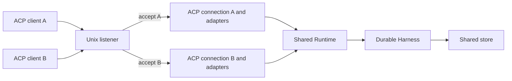

+++
status = "draft"
created = 2026-11-18
last_update = 2026-11-19
+++

# Unix socket transport for ACP v1

## Purpose

Let multiple ACP clients use the same running pid-acp process concurrently.
Each client uses its own connection and conversation.

## Context

[007](007-multiple-conversations.md) shares a Durable Harness across conversations. Today `src/stdio-server.ts` connects one `AcpServer` to stdin/stdout. That `AcpServer` routes requests to attached sessions and closes the Runtime when the connection ends. With multiple connections, routing stays local and the Runtime outlives any one connection.

## Goals

- Serve independent, concurrent ACP v1 connections through one Node Unix socket listener, without forking.
- Keep one Runtime, Harness and store; preserve the persistent store's existing `owner.lock`.
- Keep stdio as the default and preserve existing session, prompt, steering, cancellation and recovery semantics.

## Non-goals

No ACP v2 migration, TCP endpoint, stdio proxy, Docker changes, multi-user authorization, push to disconnected clients or automatic reconnect. Concurrent attachment to the same saved session is outside scope: clients must use distinct sessions while connected, and the server need not enforce that across connections. This is a custom transport for socket-aware clients, not a new standard ACP transport.

## Specification

### Selecting and protecting the endpoint

With `PID_ACP_SOCKET_PATH` unset, pid-acp serves only stdio. When set, it must be a nonempty absolute path to a filesystem Unix stream socket (for example `/run/pid-acp/acp.sock`). Pass the path unchanged to `listen()` and let it reject invalid or occupied paths. Bind failure must fail startup, not fall back to stdio. Storage selection remains independent. In socket mode stdin and its EOF have no protocol or shutdown role; stdout stays empty.

The operator must provide an existing parent directory owned by the service user with mode `0700` and a path other users cannot replace. Check the parent directory's owner and mode without walking its ancestors. The socket must have mode `0600` before serving requests. Permission errors must fail startup. Any client admitted here is trusted to act as the service user; session routing is not a sandbox.

Leave existing path entries untouched. After a crash the operator must confirm the listener is gone before removing a stale socket. The operator must leave the bound path in place while the listener runs. Clean shutdown must remove the endpoint created by this listener. Report corrective guidance on stderr without protocol payloads, transcripts or credentials.

### Connections and attachments



Each accepted socket carries its own full-duplex UTF-8 newline-delimited JSON-RPC stream. Use the same SDK framing, validation, size limits and error responses as stdio: a frame is one message plus newline, not one socket read. SDK 2.0.1's root export targets stable v1; `ndJsonStream(output, input)` accepts Web streams and `app.connect(stream)` returns a connection with `closed` and `close()`. Each connection initializes independently and sees the existing capability advertisement. Responses, errors, request IDs, send queues and `session/update` notifications stay on that connection. Equal IDs on different sockets must not collide.

A connection may own several sessions. Keep the adapter map, in-progress opens, and update sinks local to that connection. Prompt and steering require a locally attached ID; reject foreign IDs like unknown IDs. Ignore cancel for a foreign ID, without replying. An explicit cancel on an attached ID affects only its conversation.

Different connections must be able to open and run distinct sessions concurrently. An open or replay that fails or loses its connection must clean up its attachment without publishing it for further requests.

### Lifetime

Each socket has its own `AcpServer` request handler and adapter map. The process owns the Unix listener and shared Runtime. `detach()` closes only that handler's attachments. Process shutdown waits for pending detaches before closing the Runtime.

```ts
const runtime = await Runtime.open(/* existing launch configuration */);
const listener = createServer((socket) => {
  const acp = new AcpServer(runtime);
  const wire = ndJsonStream(Writable.toWeb(socket), Readable.toWeb(socket));
  const connection = acp.createApp().connect(wire);
  trackConnection(connection, () => acp.detach());
});
// Process shutdown: stop accepting, close and detach connections, close runtime.
listener.listen(socketPath);
```

EOF, reset, failed send or terminal SDK stream error stops admission and delivery on that socket only. Detach must stop watchers and unblock attachment waiters without recording user cancellation, waiting for native work to finish or closing shared resources. A missed response is never sent on another connection. The listener survives the last disconnect. To return, initialize a fresh connection and explicitly `session/load` the saved ID with its matching cwd after detach. Persistent load replays existing native history, not missed wire frames, and does not resubmit input. Transient mode still rejects load.

SIGINT, SIGTERM, fatal listener failure or `runtime.failure` must stop accepting sockets and requests, close transports, settle pending opens or rollbacks, and detach every connection, then close the shared Runtime once, including work without an attachment. Keep the four-second deadline for the whole shutdown. Release `owner.lock` through normal Runtime cleanup after Harness/storage close; never unlink it. Fatal failures, cleanup failure or deadline exhaustion require a nonzero exit. In stdio mode connection EOF still initiates process shutdown. Neither form of shutdown is a conversation cancel.

## Verification

Use temporary private directories, an injected deterministic provider and synchronization barriers rather than sleeps. Implementation acceptance requires:

1. Check that empty and relative paths fail configuration and that an invalid path rejected by `listen()` fails startup without falling back to stdio. Check parent ownership and permissions, socket mode bits and clean removal. Start against a live socket, stale socket and ordinary file; each attempt must fail without altering the entry. Verify startup failure releases any acquired Runtime resources.
2. Connect two real socket clients to one process. Split a frame across writes and send multiple frames in one write. Initialize both, create distinct sessions, and issue concurrent prompts with identical JSON-RPC IDs and distinguishable content. Hold both provider calls at a barrier; verify each client gets only its response and its session's updates. Malformed JSON on A gets the SDK error on A; B continues.
3. With distinct sessions attached, try prompt, steering and cancel from A using B's ID without loading it. Verify no effect on B. Cancel A's own turn and verify B can finish and prompt again. Disconnect during a saved session's replay and verify a later connection can load it after cleanup.
4. Drop A during a gated native turn, let B finish, and release A's work. Reconnect, initialize and load A: verify its completed history, no resubmission and no B data. Disconnect all clients and connect again to the same process. Confirm transient load remains unavailable.
5. Assert one Runtime/Harness/store open for both clients and no close on detach. A second process using another socket but the same persistent root must still fail on the lock. Signal shutdown with connections active and separately inject shared storage failure; verify global cleanup, exit status and subsequent lock acquisition. Restart and check native recovery without a client.
6. Run existing deterministic stdio suites unchanged, including initialize, new/load, prompt, steering, cancel, stdout framing and EOF shutdown. Socket mode must produce no protocol output on stdout and must survive stdin EOF.
